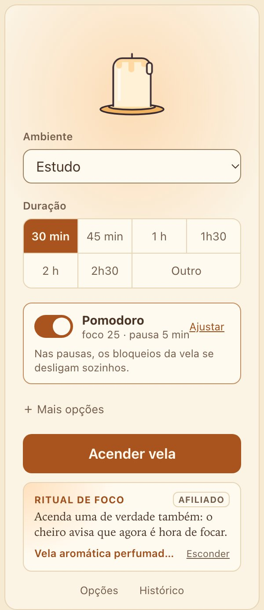
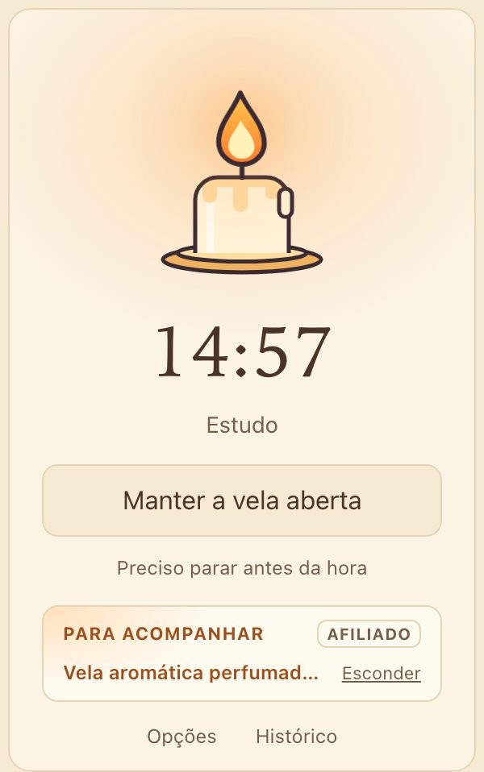
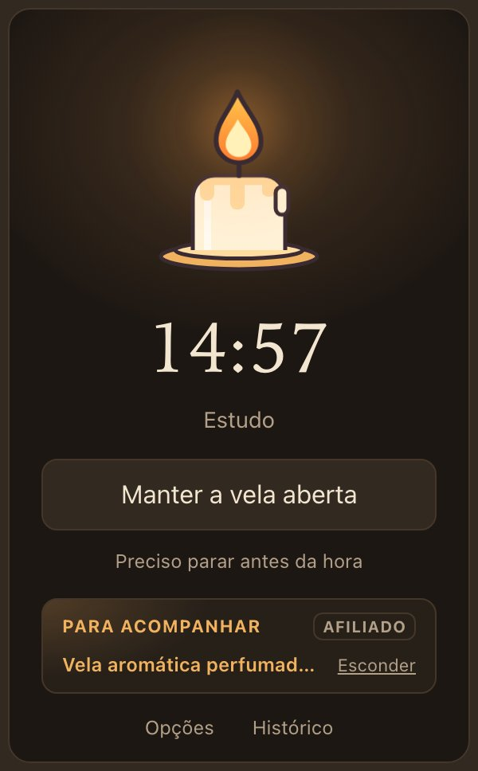
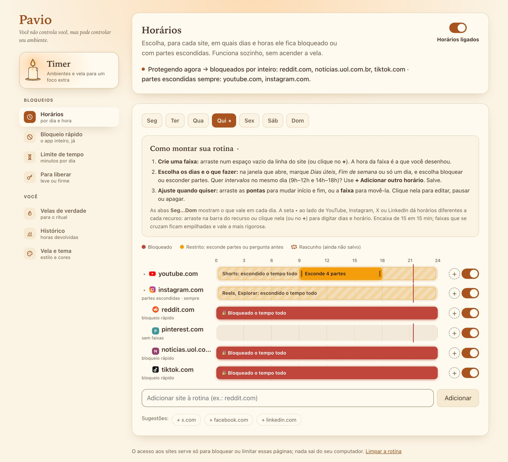
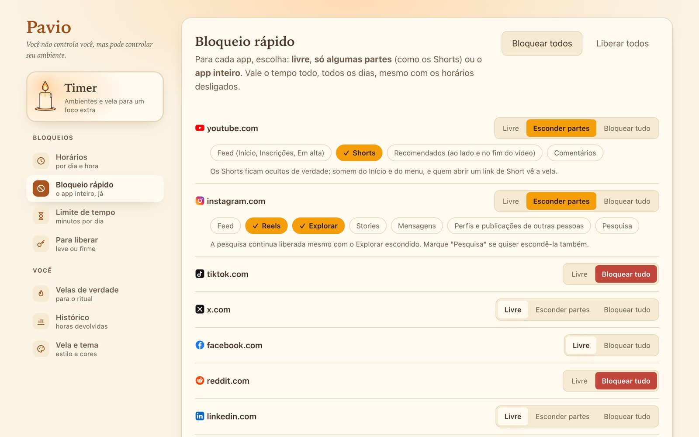
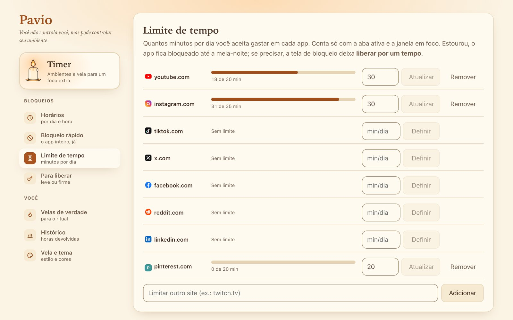
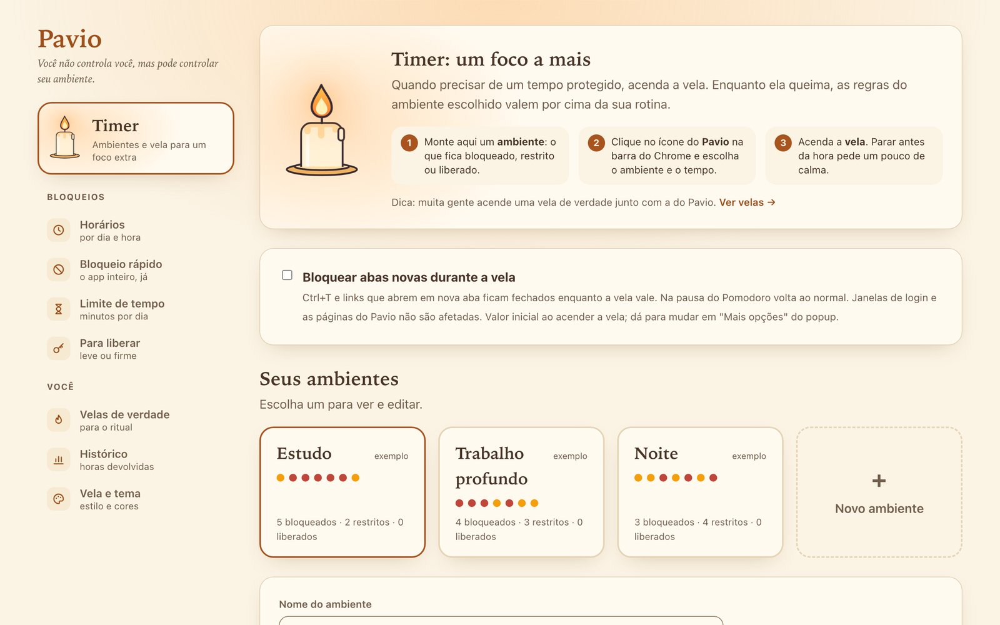
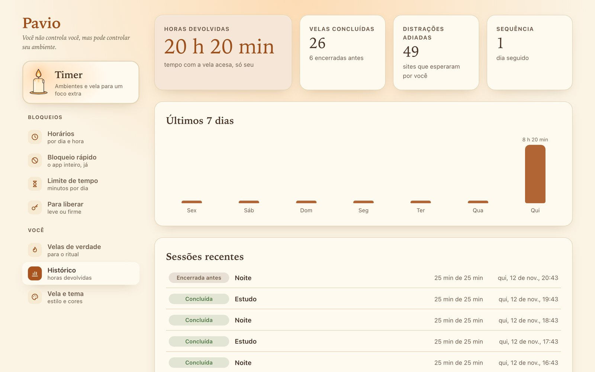

<div align="center">


# Pavio

**Você não controla você, mas pode controlar seu ambiente.**

Extensão do Chrome para foco, pensada para quem tem TDAH ou briga com a procrastinação.
Calma, aconchegante e **100% local**: sem conta, sem servidor, sem coleta de dados.

</div>

<p align="center">
  
  &nbsp;
  
  &nbsp;
  
</p>

## O que ele faz

O Pavio funciona em duas camadas que se somam.

### 1. Rotina: o ambiente se arruma sozinho

Para cada site, você diz **quando** ele fica bloqueado ou com **partes escondidas**. Funciona sozinha, sem você precisar lembrar de ligar nada.

- **Horários:** uma linha do tempo de 24 h por site. Arraste para criar uma faixa, arraste as pontas para ajustar, escolha dias úteis, fim de semana ou dias soltos.
- **Esconder partes em vez de bloquear tudo:** some com os **Shorts** e os recomendados do YouTube, com o **feed, Reels e Explorar** do Instagram, com o **"Para você"** do X e com o **feed** do LinkedIn, e o resto do site continua funcionando.
- **Bloqueio rápido:** um clique e o app inteiro fica bloqueado, o tempo todo.
- **Limite de tempo:** por exemplo, 30 minutos de Instagram por dia. Passou disso, só volta amanhã.

<p align="center">
  
</p>

<table>
  <tr>
    <td></td>
    <td></td>
  </tr>
  <tr>
    <td align="center"><sub><b>Bloqueio rápido</b>: livre, esconder partes ou bloquear tudo</sub></td>
    <td align="center"><sub><b>Limite de tempo</b>: minutos por dia em cada app</sub></td>
  </tr>
</table>

### 2. Timer: uma vela para o foco extra

Quando precisar de um tempo protegido, **acenda a vela**. Enquanto ela queima, valem as regras de um **ambiente** (Estudo, Trabalho profundo, Noite… você cria os seus) por cima da rotina.

- **Tempos prontos** (30 min a 2h30) com **Pomodoro** já sugerido: nas pausas, os bloqueios da vela se desligam sozinhos.
- **Fricção gentil para desistir:** no modo Leve, basta confirmar; no Firme, é preciso digitar uma frase. Sem esperas punitivas.
- **A vela à vista:** o ícone da barra mostra os minutos que faltam, e a vela pode ficar numa janelinha sempre por cima.

### Quando você tenta abrir um site bloqueado

Em vez de uma tela de erro, aparece a vela e uma frase calma. Se você realmente precisa do site, dá para **liberar por 5, 15 ou 30 minutos**, e ele volta a ser bloqueado sozinho. Quando o bloqueio acaba, a página volta para onde você estava.

<p align="center">
  
</p>

<table>
  <tr>
    <td></td>
    <td></td>
  </tr>
  <tr>
    <td align="center"><sub><b>Ambientes</b>: o conjunto de regras de cada vela</sub></td>
    <td align="center"><sub><b>Histórico</b>: horas devolvidas a você</sub></td>
  </tr>
</table>

## Privacidade

- **Tudo fica no seu navegador** (`chrome.storage.local`). Não há servidor, conta nem analytics, e o código não faz nenhuma requisição de rede.
- O acesso aos sites é pedido **um por um**, só para os que você escolhe bloquear.
- Os links de velas de verdade (opcionais e desligáveis) são links de afiliado e são indicados como tal.

## Rodando localmente

Precisa de Node.js 20.19 ou mais recente (ou 22.12+).

```bash
npm install
npm run dev      # compila em dist/ e atualiza sozinho
```

No Chrome, abra `chrome://extensions`, ligue o **Modo do desenvolvedor**, clique em **Carregar sem compactação** e escolha a pasta `dist/`.

| Comando | O que faz |
|---|---|
| `npm run dev` | desenvolvimento com recarga automática |
| `npm run build` | versão final em `dist/` |
| `npm test` | testes (Vitest) |
| `npm run typecheck` / `npm run lint` | tipos e lint |
| `npm run harness` | telas no navegador comum, com dados de exemplo (`http://localhost:5199/harness/options.html`) |
| `npm run package` | zip para a Chrome Web Store |

## Como é feito

- **Manifest V3**, TypeScript estrito, [Preact](https://preactjs.com/), Vite + CRXJS, CSS puro com tokens de tema (creme e noite).
- A lógica fica em `src/core/`: é **pura e testada**, sem nada do Chrome, e chega à plataforma por interfaces (`src/core/ports.ts`).
- Os bloqueios usam `declarativeNetRequest`; as partes escondidas (Shorts, feed…) usam content scripts que leem só a política calculada.
- Detalhes de arquitetura e decisões de produto estão em [`CLAUDE.md`](CLAUDE.md).
